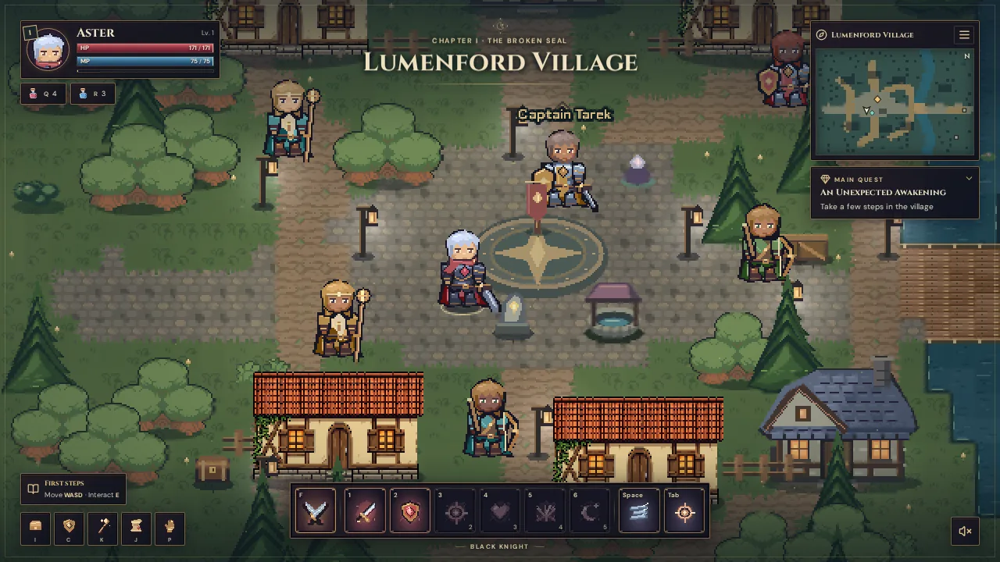
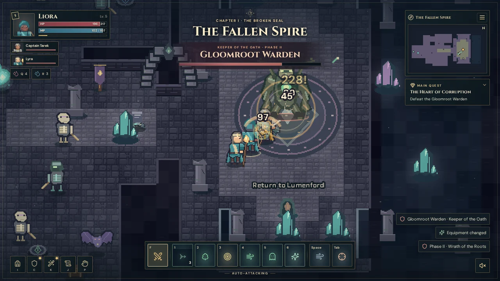

# Eclipse of the Veil

**Chapter I: The Broken Seal** is a browser-playable, single-player fantasy action RPG. An unnatural bell wakes Lumenford, and the mark on your hand answers. Create a Veilbound, investigate the eastern road, recruit a party, and find out what the Gloomroot Warden was guarding.

This is an original, unofficial fan project inspired by the style of *Inotia 4*, formerly scoped as “Inotia 5: Eclipse of the Veil.” The public title is **Eclipse of the Veil**. It is not licensed, endorsed, or affiliated with Com2uS and does not use its game assets or code.



## Run or play

Requires Node.js **22.12+** and npm. No account, backend, API key, or environment variables are required.

```sh
npm ci
npm run dev
```

Open the address printed by Vite. Choose **New Game**, a class, and **Begin Adventure**. Take a few steps, target the spark, and talk to Captain Tarek in the square. The journal and gold minimap markers point to the next objective. Shrines restore the party and set a revival checkpoint. After a level-up, spend your points in **Character** and **Skillbook** rather than leaving them unused.

```sh
npm run build     # TypeScript check, static build, versioned service-worker precache
npm run preview   # Serve dist/ locally, including offline behavior
```

The production build becomes offline-capable after the worker finishes caching (the title screen says **Offline ready**). Supported browsers may offer **Install** or **Add to Home Screen**. Use HTTPS or `localhost` for service workers. Saves are per browser profile and origin; move them with **Export Save** in Pause and **Import Save** in Load Game. Audio is muted on first launch; enable it from the title or HUD.

### Controls

| Desktop | Action |
| --- | --- |
| WASD or arrows | Move |
| Left click | Walk to a point, approach an interaction, or chase and auto-attack an enemy |
| Tab / F | Cycle visible targets / engage the target |
| 1–6 | Use a learned class skill |
| Space | Dodge in the movement or facing direction |
| E | Talk, gather, pick up, rest, or travel at the prompt |
| Q / R | Drink a health / mana tonic |
| I / C / K | Inventory / character / skillbook |
| J / M / P | Journal / map / party |
| F1 / F2 / F3 | Control the hero or an active companion |
| Esc | Dismiss, close, or pause |

On touch, use the left joystick and on-screen buttons, or tap destinations, NPCs, and enemies. Landscape gives the most room. Settings include three difficulty modes, touch-control visibility, separate audio volumes, and a motion toggle.

## Chapter content and systems

- Six customizable classes: Black Knight, Assassin, Warlock, Priest, Ranger, and Warrior. Each has six working skills and three ranks per skill. Two start learned; the rest unlock with levels and skill points.
- Four connected main maps: Lumenford Village, Whisperpine Road, Hollowwood Forest, and the Fallen Spire. Ashen Pass opens as a short playable epilogue.
- Ten main quests, four side quests, a three-rune puzzle, treasure caches, and a recorded choice about the Oath Shard.
- Eleven combat enemy definitions including the tutorial spark and the Gloomroot Warden. The Warden changes phases at 70% and 35% HP, with telegraphed swings, root spikes, projectile barrages, summoned adds, and recovery windows.
- A three-person party with Captain Tarek and Lyra, four AI profiles, healing, and freely switchable control. Companion gear uses the same inventory UI as the hero.
- Real-time melee and projectiles, dodge, HP/MP, cooldowns, status effects, loot, death, and shrine revival. Hero level cap is 100; content progression is balanced for Chapter I, not endgame.
- 36 inventory slots, ten equipment slots, six rarities, stat comparisons, buying/selling, recipes, and deterministic enhancement up to +3.
- Three local save slots, manual/autosaves, IndexedDB with a localStorage safety mirror, versioned validation, and JSON export/import. Persistent bosses and treasure do not respawn; regular encounters repopulate on map entry.
- Bundled title and chapter illustrations, original procedural pixel-art sprites and terrain, original synthesized music and effects, and self-hosted fonts. Third-party notices are in [`public/licenses/`](public/licenses/).



## Code layout

| Path | Responsibility |
| --- | --- |
| `src/data/` | Classes, skills, NPC looks, items, enemy loot tables, quest dialogue and objectives, authored map layouts |
| `src/game/model.ts` | 60 Hz gameplay simulation, command API, AI, combat, quest events, and interactions |
| `src/game/navigation.ts` | Tile collision, exact grid line of sight, and A* routing shared by player and AI |
| `src/game/progression.ts`, `inventory.ts`, `save.ts` | Combat formulas and leveling, atomic item transactions, save normalization and persistence |
| `src/game/WorldScene.ts`, `pixels.ts`, `audio.ts` | Phaser camera, world layers, generated atlases, telegraphs and particles, and Web Audio |
| `src/app/`, `src/ui/` | React screens, HUD, touch and keyboard controls, minimap and RPG menus |
| `scripts/service-worker.mjs` | Generates a versioned offline cache from the actual production output |
| `tests/` | Deterministic simulation tests and production-build Playwright scenarios |

Phaser handles the real-time renderer, pointer coordinates, camera, and scaling. The tile-grid simulation and collision are engine-independent so the same rules can run in deterministic tests. World assets are generated from authored tile and placement data rather than requiring Tiled or Phaser Arcade. Sprites use frame-based atlases and Y-depth sorting; terrain is cached in 16×16-tile chunks.

## Validation

```sh
npm test
npm run build
npx playwright install chromium
npm run test:e2e
```

`npm run test:e2e` starts Vite's production preview on port 4317. If Chromium is managed separately, set `PLAYWRIGHT_CHROMIUM_EXECUTABLE_PATH` to its executable. `VEILBOUND_SOFTWARE_CANVAS=1` forces the Canvas fallback for headless environments without accelerated graphics.

| Verification | Result |
| --- | --- |
| TypeScript and static production build | Pass |
| Vitest | **23 passed**. All ten main quests and the epilogue completed on all six classes through simulation inputs. All 36 abilities exercised, plus wall/dodge collision, mana and cooldowns, party healing, defeat/revival, quest reward uniqueness, crafting, gear, and save round-trips. |
| Playwright Chromium against the production build | **3 passed**. Desktop creation, keyboard combat, leveling, travel, IndexedDB, offline reload; emulated landscape touch movement, combat, and inventory; imported late-chapter save, party/equipment UI, Warden phase change and victory, and save export. No uncaught page or console errors in those scenarios. |

Browser tests ran in Chromium; physical Android/iOS device performance and the browser's standalone install prompt were not verified. The all-class chapter runs are simulation tests, not six manual browser playthroughs. A 30–45 minute human playtime has not been measured.

## Deploy to Vercel

`vercel.json` defines the Vite preset, `npm ci`, `npm run build`, `dist/`, SPA fallback, and cache headers. No Vercel project has been linked for this repository yet.

- **From your local checkout:** run `npm ci && npm run build`, then `npx vercel`. In the CLI, link an existing project or create a new project for this game. Deploy to preview first. When you are ready for production, run `npx vercel --prod`.
- **From GitHub:** push the game branch, import `kimpoy813/inotia5` into a dedicated Vercel project, and deploy the branch carrying this source. Check that the project uses Node 22 or newer. Do not expect an earlier `main` checkout containing only the initial README to build the game.

After deployment, open the HTTPS deployment, start a game, save, reload and Continue. To verify the PWA, wait for **Offline ready**, take the browser offline, reload, and resume the same save.

## Expansion scope

The chapter and its stinger are implemented; **Acts II–V and endgame are not**. Ashen Pass is a small epilogue, not a second act. Future content includes the capital and its competing factions (Act II), the lost guardian sanctuaries (Act III), the broken covenant and its consequences (Act IV), and Malrec’s citadel and full campaign endings (Act V). The full 90-skill catalogue, larger mercenary roster, extra maps and bosses, cinematic camera cutscenes, key rebinding, and endgame modes are expansion work, not advertised as finished in this release.
