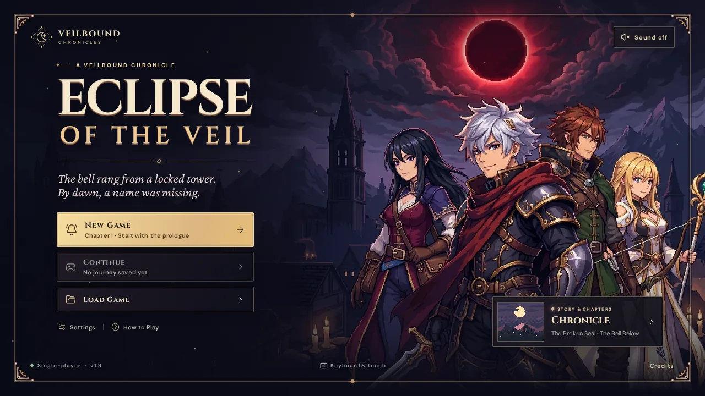
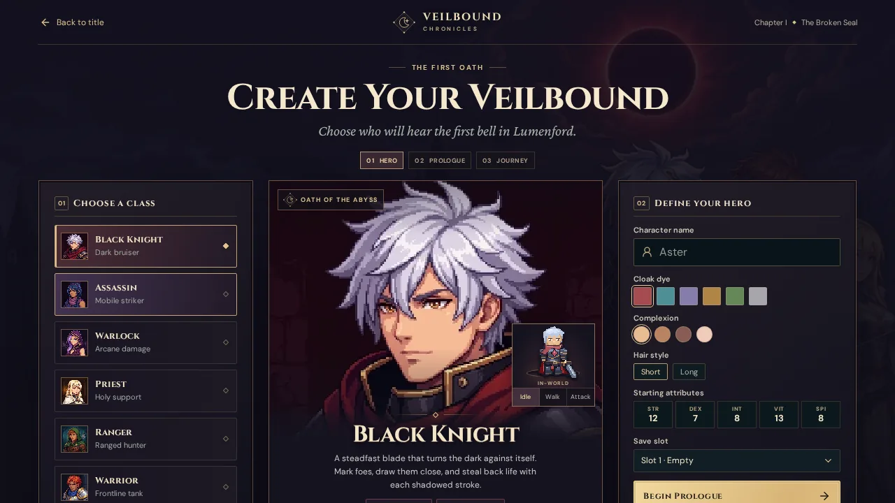
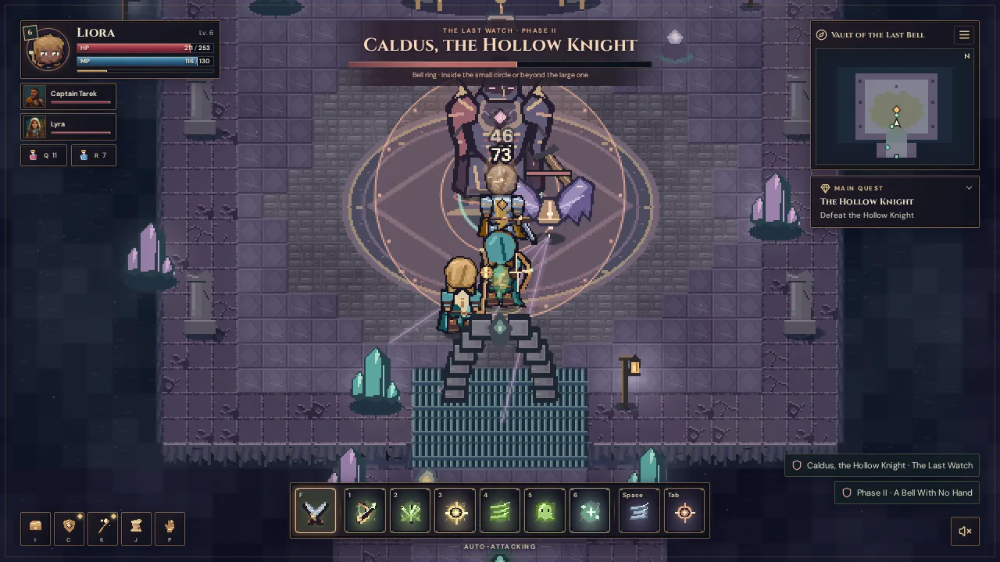

# Eclipse of the Veil

**Two playable chapters of an offline, single-player pixel-art action RPG.** A bell wakes Lumenford and the mark on your hand answers. In **The Broken Seal**, follow the disappearances to the Fallen Spire. In **The Bell Below**, cross Ashen Pass into a capital that has been keeping peace by taking people’s names out of the world.



The art refresh uses the supplied pixel-art showcase as visual direction: a crimson-eclipse cover, six illustrated classes, four-direction character sprites, more detailed terrain, and gold-framed pixel icons. The artwork is new; the game still plays the same two chapters and reads existing saves.



## Play

Use the **Eclipse of the Veil** Arena preview, or run the game locally. For the full story, choose **New Game**. To jump to the new chapter, select **The Bell Below** card on the title screen, then **Start in Chapter II** in the Chronicle. You get a level-six hero in Ashen Pass with four learned skills, Tarek, Lyra, and the Oath Shard. This makes a new journey in a slot you select and asks for confirmation before replacing any occupied slot. Speak to Veyra near the overlook and decide what to tell the Crown.

**Continuing an existing journey?** No restart is required. Use **Continue** on the same origin or **Load Game → Import Save** with a Chapter I export. Finished Chapter I saves get **A Bell for the Living** in the journal. Follow the gold markers to Ashen Pass. If the earlier shard choice was left unanswered, Veyra asks for it there. On a different preview URL, export from the old one and import into the new one; browser saves do not travel between origins automatically.


### Local setup

Requires Node.js **22.12+** and npm. There are no game accounts, backend services, environment variables, or mandatory asset CDNs.

```sh
npm ci
npm run dev
```

Open the address printed by Vite. New Chapter I players: move a few steps, dispel the spark, and report to Captain Tarek. The journal and gold map markers guide both chapters. Shrines restore your party and set a checkpoint. Spend earned points in **Character** and **Skillbook**.

```sh
npm run build       # Type check, static dist/, and versioned offline cache
npm run preview     # Serve the production build to test offline support
```

After the production title screen says **Offline ready**, a cached installation can reload and continue without a connection. Supported browsers may offer **Install** or **Add to Home Screen**. Service workers require HTTPS or `localhost`; after an update, close old game tabs before reopening to give the new worker a chance to activate. Saves live in three local IndexedDB slots with a localStorage safety mirror. Use **Pause → Export Save** to back up a journey. Audio starts muted; use the sound switch to hear the original score and effects.

### Controls

| Desktop | Action |
| --- | --- |
| WASD / arrow keys | Move |
| Left click | Walk to a point, approach an interaction, or engage an enemy |
| Tab / F | Cycle visible targets / auto-attack the target |
| 1–6 | Use a learned class skill |
| Space | Dodge in the movement or facing direction |
| E | Interact at the prompt; advance dialogue |
| Q / R | Drink a health / mana tonic |
| I / C / K | Inventory / character / skillbook |
| J / M / P | Journal / map / party |
| F1 / F2 / F3 | Control the hero or one of the two active companions |
| Esc | Dismiss, close, or pause |

On touch, use the joystick and action buttons or tap the world. Landscape gives the most room ([landscape HUD](docs/touch-hud.webp) · [portrait HUD](docs/portrait-touch.webp)). Settings offer Story, Adventure, and Veteran difficulty; automatic, always-on or hidden touch controls; reduced motion; and separate volume controls.

## What’s in the game

| Content | Included |
| --- | --- |
| Chapters | The Broken Seal and The Bell Below, **16 main quests**, **6 side quests**, and **8 connected maps** |
| Chapter II | Rainlit Vesperhold, the Drowned Archive’s two-wheel floodgate, and the Vault of the Last Bell. The shard decision changes the entrance, encounters, and dialogue. A separate ending changes how the city handles the recovered names and which accessory you earn. |
| Characters | Recruit Captain Tarek, Lyra, and Veyra. Bring two companions, switch control, and set their tactics. Illustrated scenes bring Seris, Archivist Iona, and Malrec into the story. |
| Field journal | Track quests, read discovered memories, look up people, and check the bestiary for combat tells. |
| Encounters | **16 enemy types**, including Siltmaw charge lanes, Bellwing projectile fans, Crown Bailiff frontal guard, the Archive Husk, and two three-phase bosses. Look for the safe centre or outer edge of the Hollow Knight’s ring. |
| Classes and gear | Six customizable classes, six working abilities with three ranks per class, five attributes, 36 bag slots, ten equipment slots, six rarities, crafting, shops, and enhancement up to +3. The level cap is 100; the current campaign is balanced for early progression, not endgame. |




More gameplay: [Lumenford Village](docs/lumenford.webp) · [Equipment and inventory](docs/inventory.webp) · [Gloomroot Warden](docs/gloomroot.webp)

## Implementation

- **Phaser** renders the world and handles the camera and world pointer input. Terrain is cached in 16×16-tile chunks. Actors are Y-sorted animated pixel atlases; world entities are not DOM elements.
- The **TypeScript** simulation ticks independently, with fixed-step combat, A* routing, exact grid line of sight, collision, status effects, gear progression, and persistent quest events. `src/game/patterns.ts` shares telegraph geometry with the gameplay rules.
- **React** owns the HUD, journal, menus, dialogue, hero creation, and accessible controls. `src/game/audio.ts` provides original Web Audio music and effects.
- `src/data/` contains maps, dialogue, quests, encounters and lore. `src/game/peopleArt.ts` draws the character atlases, `src/game/pixels.ts` draws terrain and creatures, and `src/game/iconArt.ts` caches pixel icons for the HUD, skills, and gear. `public/art/` holds generated illustrations, portraits, and three scenery sprites with procedural fallbacks. Third-party notices are in [`public/licenses/`](public/licenses/).
- `scripts/service-worker.mjs` fingerprints and precaches the production files. Save validation in `src/game/save.ts` retains Chapter I’s schema and identifiers.

## Validation

```sh
npm test
npm run build
npx playwright install chromium
npm run test:e2e
```

The Playwright suite starts the production preview on port 4317. For an existing browser binary, set `PLAYWRIGHT_CHROMIUM_EXECUTABLE_PATH`. Set `VEILBOUND_SOFTWARE_CANVAS=1` for a headless environment without WebGL acceleration.

- **35 Vitest tests:** both chapters completed in deterministic simulations on all six classes; one complete Chapter II quick-start run; both archive routes and final decisions; side quests, companions, new telegraphs, gates, save compatibility, and the original skills, combat and economy regressions.
- **9 Playwright scenarios:** art assets, animated class preview and pixel icons; portrait touch layout; desktop and landscape-touch combat; the Warden and save import/export; an old save entering Vesperhold and resuming offline; the separate Chapter II touch start; crossing the opened Archive grating; and the Last Bell encounter and ending.
- Strict TypeScript and the production build pass. Tests use Chromium, including emulated touch, not a physical-device benchmark or a timed human playthrough. Chapter III and beyond, endgame, and the full planned campaign are not included.

## Deploy

`vercel.json` configures the Vite build, `dist/` output, SPA fallback, and service-worker cache policy. The GitHub repository `kimpoy813/inotia5` is linked to the `inotia5` Vercel project.

1. To preview changes, deploy the branch containing this release from the project dashboard, or run `npx vercel link --project inotia5` and then `npx vercel` from the checkout. Select the project’s existing workspace and use Node 22 or newer. Use a preview before intentionally promoting to production.
2. Open the deployment over HTTPS, start a game, save, and reload using **Continue**. Wait for **Offline ready**, go offline, and reload again to verify the cached release.

The static `dist/` output also works on other HTTPS hosts with SPA fallback to `index.html` and a revalidated `/sw.js`.

*Eclipse of the Veil* is an original, unofficial project inspired by *Inotia 4*. It is not licensed, endorsed, or affiliated with Com2uS and does not use its assets or code.
